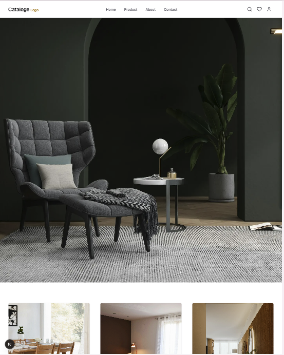
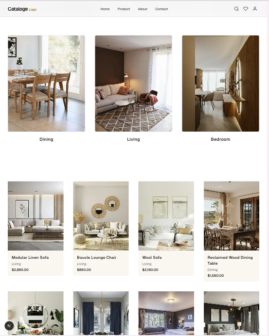
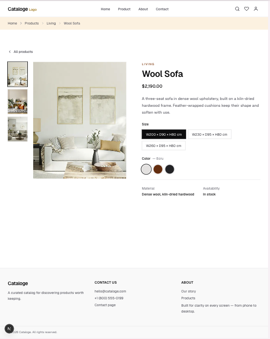
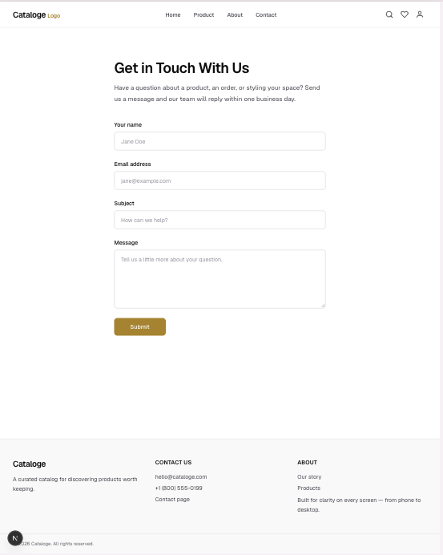
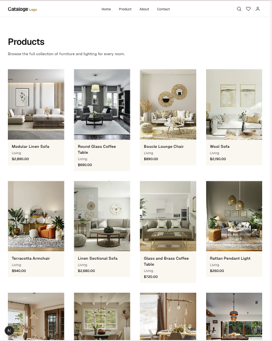
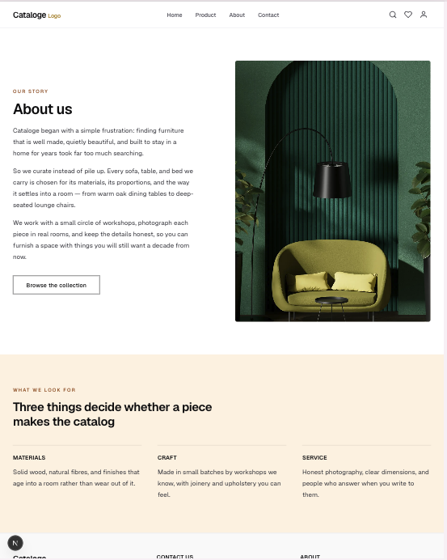

# Cataloge

A room-by-room furniture catalog built with the Next.js App Router — browse living, dining, and bedroom pieces, then open a product to explore its gallery, sizes, and finishes.

## Overview

Cataloge is a small storefront-style catalog: a hero home page, three room landing pages, a full product index, individual product detail pages, and supporting inspiration, about, and contact pages. It is aimed at anyone who wants a clean, image-led way to browse furniture.

The catalog itself is static data (26 products: 8 living, 10 dining, 8 bedroom) defined in TypeScript, so the project runs with no database, API, or environment variables.

## Screenshots


Uncomment and fill these in after adding the images to public/screenshots/.

| Home | Category |
| --- | --- |
|  |  |

| Product detail | Contact |
| --- | --- |
|  |  |

| Products | About |
| --- | --- |
|  |  |

## Tech Stack

| Layer      | Technology                                                                                     |
| ---------- | ---------------------------------------------------------------------------------------------- |
| Framework  | [Next.js](https://nextjs.org) 16.3.8 (App Router, Server Components)                           |
| UI library | React 19.2.8 / React DOM 19.2.8                                                                |
| Language   | TypeScript 5 (`strict`, path alias `@/*` → `src/*`)                                            |
| Styling    | Tailwind CSS 4 via `@tailwindcss/postcss`, with `@theme` tokens                                |
| Icons      | react-icons 5 (`react-icons/fi`)                                                               |
| Linting    | ESLint 9 with `eslint-config-next` (core-web-vitals + TypeScript) and `eslint-config-prettier` |
| Formatting | Prettier 3 with `prettier-plugin-tailwindcss`                                                  |

Fonts are Geist and Geist Mono, loaded with `next/font/google` in `src/app/layout.tsx`.

## Features

- **Home page** (`/`) — hero banner, "shop by room" tiles, a curated featured grid, and an inspiration section, composed in `src/app/page.tsx`.
- **Shop by room** — three tiles in `src/components/RoomCategories.tsx` linking to `/dining`, `/living`, and `/bedroom`.
- **Featured products** — `src/components/FeaturedProducts.tsx` renders eight hand-picked ids (`featuredIds` in `src/data/products.ts`) through the shared `ProductGrid`.
- **Category pages** (`/living`, `/dining`, `/bedroom`) — a single `src/components/CategoryProductList.tsx` filters products by room and shows an empty state when a room has none.
- **Full catalog** (`/product`) — the product index rendering all 26 items in a responsive 1 → 2 → 4 column grid.
- **Product detail** (`/product/[id]`) — server-rendered page with a client-side image gallery (`ProductGallery`), size buttons and color swatches (`ProductOptions`), USD price from `src/lib/formatPrice.ts`, material and availability, and a link back to the catalog. Unknown ids call `notFound()`.
- **Breadcrumbs** — `src/components/Breadcrumbs.tsx` renders Home / Products / … on category and product pages.
- **Inspiration** (`/inspiration`) — three room photographs with captions and a call to action back to the catalog.
- **About** (`/about`) — brand story plus three brand values in a sand-colored band.
- **Contact** (`/contact`) — client-side form with required name, email, subject, and message fields, a gold submit button, and an inline confirmation. Nothing is sent to a server.
- **Header and footer** — sticky header with desktop nav, a mobile menu toggle, and search/favorites/profile icon buttons (visual only), plus a three-column footer with contact details.
- **Metadata** — most routes export their own `Metadata` for titles and descriptions, and product titles and descriptions are generated from the product record.

## Getting Started

Requires Node.js 20.9.0 or later (the minimum declared by Next.js 16).

```bash
git clone <REPO_URL>
cd <REPO_DIR>
npm install
npm run dev
```

Open [http://localhost:3000](http://localhost:3000).

## Available Scripts

| Command                | Description                  |
| ---------------------- | ---------------------------- |
| `npm run dev`          | Start the development server |
| `npm run build`        | Create a production build    |
| `npm run start`        | Run the production server    |
| `npm run lint`         | Run ESLint                   |
| `npm run lint:fix`     | Fix ESLint issues            |
| `npm run format`       | Format files with Prettier   |
| `npm run format:check` | Check Prettier formatting    |

## Project Structure

```text
.
├── public/                        # Static files served from the site root
├── src/
│   ├── app/                       # App Router: routes, layout, global CSS
│   │   ├── about/                 # /about story page
│   │   ├── bedroom/               # /bedroom category listing
│   │   ├── contact/               # /contact page wrapping ContactForm
│   │   ├── dining/                # /dining category listing
│   │   ├── inspiration/           # /inspiration room gallery
│   │   ├── living/                # /living category listing
│   │   ├── product/               # /product routes
│   │   │   ├── [id]/page.tsx      # /product/[id] detail (prerendered)
│   │   │   └── page.tsx           # /product index
│   │   ├── globals.css            # Tailwind import, theme tokens, base styles
│   │   ├── layout.tsx             # Root layout, fonts, metadata, header/footer
│   │   └── page.tsx               # Home page composition
│   ├── components/                # Shared UI (Header, Footer, ProductCard, …)
│   ├── data/                      # Static catalog data and image wiring
│   ├── lib/                       # Small helpers (formatPrice)
│   └── picture/                   # Source images imported at build time
├── eslint.config.mjs
├── next.config.ts
├── package.json
├── prettier.config.mjs
└── tsconfig.json
```

Components in `src/components`: `Banner`, `Breadcrumbs`, `CategoryProductList`, `ContactForm`, `FeaturedProducts`, `Footer`, `Header`, `ProductCard`, `ProductGallery`, `ProductGrid`, `ProductOptions`, `RoomCategories`, `RoomInspiration`.

Only `Header`, `ProductGallery`, `ProductOptions`, and `ContactForm` are client components (`"use client"`); the rest are Server Components.

## Data Model

The catalog is a typed, in-memory data layer:

- `src/data/products.ts` — the `Product` type (`id`, `name`, `category`, `price`, `image`, `alt`, `gallery`, `description`, `sizes`, `colors`, `material`, `inStock`, optional `isNew`) and the `products` array. It also exports `getProductsByCategory`, `getProductById`, `productIds`, `featuredProducts`, and `categoryRoutes`.
- `src/data/categories.ts` — per-room marketing copy (`title`, `description`, `cover`, `alt`) keyed by slug, plus `getCategoryBySlug` and `getCategoryByLabel`.
- `src/data/images.ts` — imports every file under `src/picture/` and exposes `roomImages` plus `getProductImages(room, startIndex, count = 3)`, which slices consecutive photos from the room's gallery (wrapping at the end) and returns them as `image` (the cover) and `gallery`.

`/product/[id]` is prerendered for every entry via `generateStaticParams()` from `productIds`, so there is no runtime data fetching. There is no backend, database, or API integration — adding a product means editing `src/data/products.ts` and dropping its images into `src/picture/`.

## Theming

Styling is Tailwind-only: no CSS modules, styled-components, or external UI kit. Global styles live in `src/app/globals.css`:

- `@import "tailwindcss"` plus an `@theme` block that defines `--color-sand` (`#fff3e3`), `--color-linen` (`#fcf8f3`), and `--color-gold` (`#b88e2f`), used as `bg-sand`, `bg-linen`, `text-gold`, and so on.
- `--background` / `--foreground` tokens mapped to `bg-background` / `text-foreground`, with a `prefers-color-scheme: dark` override.
- `--font-sans` / `--font-mono` mapped to the Geist font variables set in `layout.tsx`.

Prettier runs with `prettier-plugin-tailwindcss`, so class order is sorted automatically — run `npm run format` before committing.

## Roadmap

- [ ] Implement search, favorites, and account views (the header icons are currently decorative)
- [ ] Add a cart and checkout flow — there is no purchase path yet
- [ ] Send contact form submissions somewhere (email, route handler, or form service)
- [ ] Move the catalog to a CMS or API instead of editing TypeScript files
- [ ] Add tests and a CI workflow for lint, format check, and build

## License

MIT. Add a `LICENSE` file with year `<YEAR>` and copyright holder `<YOUR_NAME>`.
